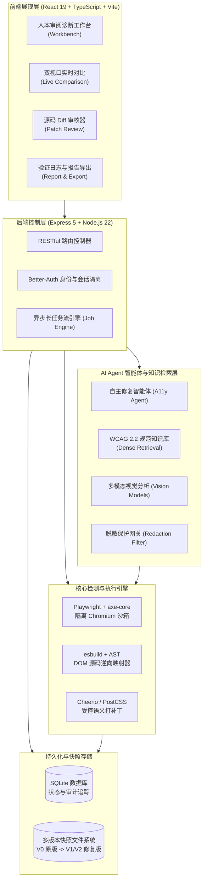
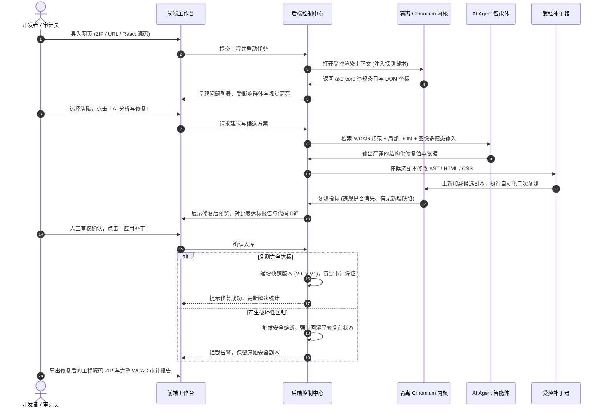

<div align="center">

# 🌐 A11y Studio · 网页无障碍智能体与受控修复平台
### *AI-Powered Accessibility Engineering & Autonomous Repair Workspace*

[](https://react.dev/)
[](https://www.typescriptlang.org/)
[](https://vitejs.dev/)
[](https://playwright.dev/)
[](https://github.com/dequelabs/axe-core)
[](https://www.w3.org/TR/WCAG22/)
[](docs/AI_WORKFLOW.md)
[](LICENSE)

<p align="center">
  <b>面向现代 Web 时代的 AI 原生无障碍工程平台</b><br>
  首创「浏览器 DOM ↔ 源码 AST 双向映射」与「隔离沙箱受控复测闭环」，<br>
  让每一位开发者和视障、弱视、听障用户共享无障碍的数字世界。
</p>

[✨ 核心亮点](#-核心创新与产品亮点) •
[🏗️ 系统架构](#-系统架构与工作流) •
[🚀 快速启动](#-快速启动与环境搭建) •
[🤖 AI 智能体配置](#-ai-能力与模型集成) •
[📊 评测与自动化测试](#-评测与测试矩阵) •
[🏆 大赛对标与社会价值](#-大赛赛道对标与社会价值)

---

</div>

## 📖 项目愿景与解决的痛点

随着全球数字化加速与《中华人民共和国无障碍环境建设法》的正式施行，构建**人人可及、消除数字鸿沟**的网页体验已成为企业合规与社会包容的刚性需求。然而传统网页无障碍建设面临三大难以逾越的鸿沟：

1. **自动检测覆盖有限，人工复核成本极高**：常规工具仅能基于静态规则匹配约 30%–40% 的确定性缺陷，对动态交互、焦点路径、图像上下文语义无能为力；
2. **纯大模型生成代码“幻觉”严重**：通用 LLM 缺乏实时页面上下文与严格验证约束，直接打补丁极易破坏原有页面样式、交互行为甚至引入新的安全漏洞；
3. **“网页呈现”与“工程源码”深度脱节**：生产环境中的现代前端工程（如 React/Vue）经过打包后，浏览器中报错的 DOM 节点无法逆向回溯定位到原始组件的 JSX/TSX 源码行号。

**A11y Studio** 提出了 **AI Agent 原生驱动的闭环无障碍工程范式**：
> **导入（ZIP/URL/源码） → 真实浏览器渲染与自动化检测 → 多模态与 RAG 智能体规划建议 → 隔离沙箱 AST 精准修改 → 自动复测回归 → 失败回滚 / 成功归档**。

---

## ✨ 核心创新与产品亮点

```
 ┌────────────────────────────────────────────────────────────────────────┐
 │                      A11y Studio 核心技术护城河                         │
 ├───────────────────┬───────────────────┬────────────────────────────────┤
 │   🎯 闭环智能体   │   🧩 源码 AST     │   🛡️ 沙箱安全受控               │
 │   自主规划与工具  │   DOM 节点逆向    │   隔离编译复测，失败            │
 │   调用，拒绝幻觉  │   映射 JSX 行号   │   自动回滚，零代码破坏          │
 ├───────────────────┼───────────────────┼────────────────────────────────┤
 │   👁️ 多模态视觉   │   📚 权威规范 RAG │   🎨 人本审阅工作台             │
 │   图片语义理解与  │   WCAG 2.2 规则库 │   双视口实时对比，              │
 │   实测对比度计算  │   检索增强与评测  │   专为普通人与开发者双向设计    │
 └───────────────────┴───────────────────┴────────────────────────────────┘
```

### 1. 🤖 闭环 AI Agent 智能修复引擎（拒绝盲目生成）
摒弃简单的“Prompt 聊天问答”，设计了面向前端无障碍的**专用自主智能体（Autonomous A11y Agent）**。智能体在受限工具沙箱中自主执行：
* 提取页面局部 DOM 树与样式计算值；
* 结合 W3C 规则检索最佳实践；
* 规划针对特定元素（`label`、`image-alt`、`color-contrast` 等）的结构化修改方案；
* 写入独立候选快照并调用真实浏览器内核复测验证。

### 2. 🧩 首创 React 源码级 AST 逆向定位与修补（V1）
对于上传的基础 React + Vite 源码工程，编译时在 AST 中为原生元素动态注入安全跟踪锚点：
* 浏览器中 axe-core 抓到的问题元素，能**微秒级精确映射到原始 TSX/JSX 文件的组件定义与具体行号**；
* 补丁直接修改原始工程组件代码，并在独立沙箱重新触发 esbuild 构建与 Tab 键路径测试；
* 最终导出的工程开箱即用，原汁原味保留项目构建链路。

### 3. 📚 W3C WCAG 2.2 规则级 RAG 检索增强
本地构建了包含 WCAG 2.2 原生规范、失败准则（Failure Techniques）、标准修复范式（Sufficient Techniques）的密集切片知识库：
* AI 在生成修复理由与代码前，首先检索与当前 `ruleId` 最匹配的权威依据；
* 彻底消除模型在无障碍法律规范上的凭空编造；
* 随附自动化 RAG 评分与评测套件，确保建议有据可查。

### 4. 👁️ 多模态视觉理解与图文对比度实测
* **图片无障碍全自动研判**：通过接入多模态视觉模型（Vision LLM），自主判断图片是“信息传递类”还是“纯装饰背景类”，智能补全富有上下文的替代文本（Alt Text）；
* **对比度科学核算**：不仅读取 CSS 声明值，更通过渲染层像素采样结合 WCAG 相对亮度公式（Relative Luminance）真实核算前景与背景实测比，推荐达标安全色。

### 5. 🛡️ 工业级受控沙箱与安全隔离机制
* **模型零命令权限**：AI 模型永远无法直接执行 Shell 命令或遍历宿主文件系统；
* **受限补丁编译器**：仅允许通过 Cheerio 与 PostCSS 修改允许范围内的属性与 CSS 声明；
* **真实性校验与双向回滚**：新补丁应用后若引发原有规则恶化或新增违规，系统**自动回滚**保留原版本并出具原因诊断；
* **SSRF 与数据脱敏**：采集端采用私网地址严格拦截机制与请求连接池，向模型发送页面文本前自动执行隐私敏感信息脱敏（`redact.ts`）。

### 6. 🎨 人本审阅现代工作台（Human-Centered Review UI）
* **双视口实时差异对比**：左侧真实页面、右侧修复后预览，支持同步滚动与交互体验；
* **macOS 风格视口视窗**：红黄绿控制灯、拟真胶囊地址栏与元素高亮指示；
* **结构化诊断呼出**：「问题」、「原因」、「建议」三色标签直观分级；
* **代码 Diff 深度呈现**：GitHub / VS Code 风格增删高亮，一键切换局部改动或上下文。

---

## 🏗️ 系统架构与工作流

### 系统分层架构



### 闭环修复业务工作流



---

## 🚀 快速启动与环境搭建

### 1. 系统先决条件
* **Node.js**：`v22.0.0` 或更新版本（推荐通过 `nvm` 安装）；
* **操作系统**：macOS / Linux / Windows (WSL2)；
* **浏览器内核**：本机安装 Google Chrome 或 Chromium。

### 2. 克隆与安装

```bash
# 克隆仓库
git clone https://github.com/your-username/a11y-studio.git
cd a11y-studio

# 安装项目依赖 (已锁定 npm ci 规范)
npm ci
```

### 3. 环境密钥配置

复制环境变量模板并生成安全密钥：

```bash
cp .env.example .env
```

打开 `.env` 文件进行配置：

```ini
# 必须：用于身份鉴权的随机 Secret（可通过 openssl rand -base64 32 生成）
BETTER_AUTH_SECRET=your_generated_random_secret_here
BETTER_AUTH_URL=http://127.0.0.1:4173

# 端口配置（默认 4173）
PORT=4173

# 可选：Chrome 浏览器路径（若系统自动探测不到）
# CHROME_PATH=/Applications/Google Chrome.app/Contents/MacOS/Google Chrome

# AI 大模型配置（推荐 DeepSeek 或 OpenAI 兼容端点，详见后文）
AI_API_KEY=your_llm_api_key
AI_BASE_URL=https://api.deepseek.com/v1
AI_MODEL=deepseek-chat
AI_VISION_MODEL=deepseek-flash
```

### 4. 编译与启动

```bash
# 构建前端并启动全功能生产服务
npm start
```

服务就绪后，在浏览器中打开：
👉 **http://127.0.0.1:4173**

> **💡 开发调试模式**：
> 在另一终端窗口中运行 `npm run dev`，即可启动 Vite 热重载前端开发服务器。

---

## 🤖 AI 能力与模型集成

A11y Studio 兼容任何遵循 **OpenAI API 规范**的大模型提供商（如 DeepSeek、OpenAI、Claude、Gemini、通义千问、Ollama 本地大模型等）。

| 能力模块 | 触发场景 | 技术实现机制 | 模型输入与隐私考量 |
| :--- | :--- | :--- | :--- |
| **AI 智能修复方案生成** | 点击「AI 分析与修复」 | Agent 结合本地 WCAG 知识库检索，输出单值精准补丁 | 仅传递局部代码片段与相关元素上下文，敏感数据脱敏 |
| **AI 视觉多模态分析** | 图片缺少 alt 或图标无文字 | 多模态大模型（Vision LLM）解析局部截图与图片像素 | 仅向模型发送局部脱敏后的图像/切片，自主判断图片用途 |
| **实测对比度修复推荐** | 文字或控件对比度不足 | 像素拾取 + WCAG 相对亮度算法 + 模型色系推理 | 结合背景主色调，智能计算符合 4.5:1 / 3:1 标准的邻近安全色 |
| **AI 语义辅助复核** | 多页面复杂交互与语义抽检 | 针对最多 20 个候选元素名称、角色与附近文本综合推理 | 严格经过用户前端明确勾选授权（Consent）后方可触发 |

> **提示**：若暂无 API Key，系统完整支持**手工编辑与受控打补丁**功能。所有代码差异校验、沙箱编译与 axe-core 自动化复测均完全在本地离线运行！

---

## 📊 评测与测试矩阵

项目具备极高的工业级工程质量，拥有覆盖单元测试、E2E 浏览器行为仿真、并发隔离与 RAG 检索质量评估的完整验证矩阵：

```bash
# 1. 严格 TypeScript 静态类型检查 (0 错误、0 警告)
npm run typecheck

# 2. 前端快速构建验证
npm run build

# 3. 运行自动化全功能测试集 (28+ 专项测试)
npm test

# 4. 运行 WCAG 检索 RAG 基准评测
npm run eval:wcag

# 5. 运行智能修复 RAG 基准评测
npm run eval:repair-rag

# 6. 运行全链路校园综合服务场景仿真验收
npm run test:campus
```

### 真实业务场景仿真验收（Campus Acceptance）
项目随附 `tests/fixtures/campus/` 完整构建了一个多路由的综合业务系统，覆盖 **HTML 单文件**、**多页静态 ZIP**、**React + TypeScript 源码工程** 以及 **在线 URL 快照** 四类形态，系统针对 20 余项故意植入的真实缺陷（含表单、图片、ARIA、焦点跳跃、对比度等）进行了完整的全自动化通过性回归。

---

## 🏆 大赛赛道对标与社会价值

本项目专为**2026年第九届“传智杯”全国高校 IT 技能大赛 · 全国高校 AI Web 开发挑战赛**打造，精准覆盖赛道命题的全部评分维度：

```
 传智杯 AI Web 开发挑战赛评分标准 (100%)       A11y Studio 项目落地实现与优势
 ─────────────────────────────────────────────────────────────────────────────
 ✦ AI技术深度 (35%)                     ──►   自研闭环修复 Agent、多模态视觉处理、
   · 大模型集成与可控性 (16%)                  WCAG 规范级 RAG 检索、AST 隔离沙箱
   · MCP 与工具链标准调用 (4%)
   · RAG 检索与多模态 (11%)
   · 安全过滤与熔断机制 (4%)
 ─────────────────────────────────────────────────────────────────────────────
 ✦ 创新性 (25%)                         ──►   首创 DOM-AST 源码双向定位映射机制；
   · 选题创新 (10%)                            颠覆传统只报错不修复的工具局限；
   · 技术与交互创新 (15%)                      人本审阅双视口同屏互动工作台
 ─────────────────────────────────────────────────────────────────────────────
 ✦ 前端工程质量与体验 (20%)             ──►   React 19 + TypeScript 纯净组件化；
   · 前端性能与代码质量 (10%)                  毫秒级构建、现代化视觉体系；
   · UI 视觉与流式体验 (10%)                   macOS 拟真视口与 GitHub 风格 Diff
 ─────────────────────────────────────────────────────────────────────────────
 ✦ 实用性与社会价值 (20%)               ──►   消除数字鸿沟，服务全球 10 亿特殊群体；
   · 真实场景需求 (10%)                        直击企业法律合规与政务适老化刚需；
   · 社会公益与商业潜力 (10%)                  可直接集成至 CI/CD 前端发布管线
```

---

## 📁 目录结构导览

```
a11y-studio/
├── apps/
│   ├── api/                     # Node.js 22 + Express 后端引擎
│   │   ├── ai/                  # 大模型多模态视觉与对比度推理、数据脱敏 (redact.ts)
│   │   ├── scan.ts              # Playwright 隔离会话驱动与 axe-core 检测引擎
│   │   ├── repair-agent.ts      # 自主规划与受控工具调用的修复 Agent
│   │   ├── source-repair.ts     # AST 级别的 JSX/TSX/CSS 补丁编译器
│   │   ├── live-comparison.ts   # 浏览器双视口实时同步与崩溃自动容错
│   │   ├── page-diagnostics.ts  # 页面多状态诊断与文本摘要提取
│   │   └── storage.ts           # SQLite 持久化与快照目录管理
│   └── web/                     # React 19 + TypeScript + Vite 现代化前端
│       ├── src/
│       │   ├── main.tsx         # 工作台主入口、全局状态流转
│       │   ├── Evidence.tsx     # 证据可视化展示画布 (交互/Diff/语义)
│       │   ├── LiveComparison.tsx # 双视口真实对比交互面板
│       │   ├── DetectionReview.tsx # V2 行为级证据与 AI 辅助复核卡
│       │   ├── modern-polish.css # 现代化视觉打磨层 (毛玻璃/徽章/模拟器)
│       │   └── editorial-theme.css # 人本审阅杂志风主题系统
├── packages/
│   └── shared/                  # 前后端强类型契约共享包 (Types & Interfaces)
├── knowledge/
│   └── wcag/                    # WCAG 2.2 权威标准切片知识库与规则映射
├── tests/                       # 自动化测试矩阵 (并发/安全/隔离/E2E)
├── docs/                        # 详细设计白皮书与技术架构文档
└── scripts/                     # 基准测试、RAG 评估与数据生成脚本
```

---

## 🤝 贡献与开源许可

本项目基于 **MIT 许可证** 开放源码。无论是提出新功能建议、改进无障碍规则映射，还是补充测试用例，我们都由衷欢迎你的参与！

*“数字科技的飞速前行，不应落下任何一个人。”*
一起让每一个网页，都清晰、友好、人人可及！
