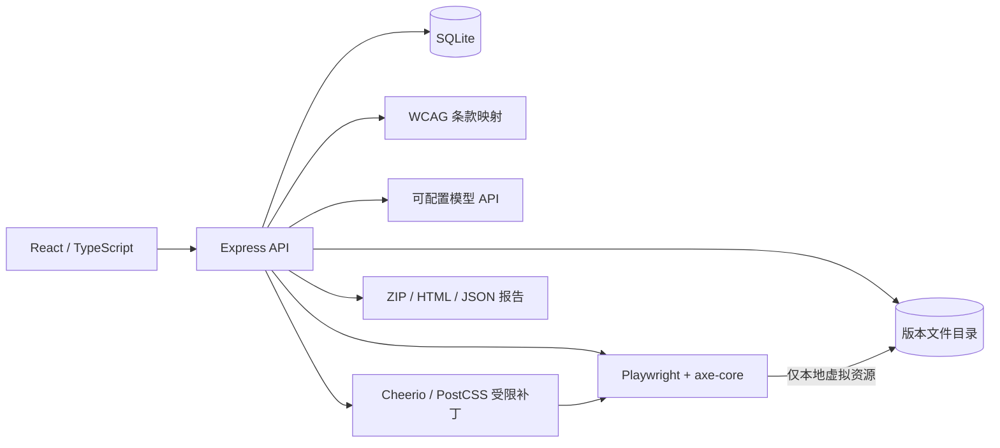

# 架构与模块边界

`apps/web` 前端；`apps/api/import.ts` 上传和压缩包验证；`scan.ts` 隔离渲染与自动检测；`repair.ts` 建议、补丁和复测；`storage.ts` SQLite 与文件版本；`knowledge/wcag` 本地规范映射；`fixtures` 为示例。`packages/shared` 记录共享数据形态。

浏览器使用独立上下文，移除上传脚本和事件属性，拦截所有非项目资源的网络请求。模型只返回单个受限修复值及理由；目标文件、规则、选择器、版本和哈希由后端确定。模型和网页内容均不具备执行命令的权限。

每次申请修复保存候选快照，重新扫描后比较规则+选择器构成的问题标识，同时检查结构、文本、交互属性和静态控件聚焦能力。颜色修复另行计算对比度；无法可靠核验时拒绝。失败候选保留证据但不设为有效版本。扫描只覆盖页面初始静态状态，不能代替业务交互测试。

任务状态：queued、running、completed、failed、cancelled；服务重启时未完成任务标记失败。请求可以取消，失败信息写入记录。
