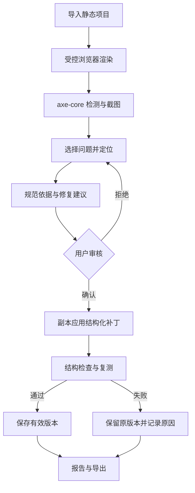

# 产品需求与验收

A11y Studio 面向网页开发者、设计师和维护人员，帮助他们定位静态网页的常见无障碍问题，并审核、应用和验证局部修复。项目对用户上传的静态文件进行处理；用户保留原始版本。

核心流程：导入 HTML/ZIP 或示例 → 自动检测 → 选择实际问题并定位 → 查看影响与规范 → 人工填写或 AI 生成建议 → 检查差异 → 明确确认 → 副本修改与复测 → 保存有效版本或回滚 → 查看报告并导出。

验收：三种示例有真实检测结果；至少图片、表单、按钮三类能生成局部补丁；通过补丁审核、实际文件修改、重扫和失败回滚；报告区分初始、解决、残留、新增及人工复核；导出 ZIP 内源码可打开并含报告。AI 未配置或失败时应明确提示，手工建议仍可用。
